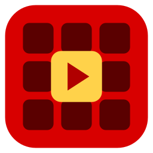
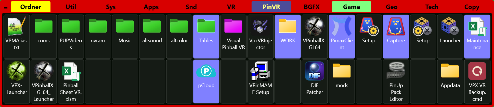

# DragLaunch

**The freely arrangeable launcher for Windows 11 – inspired by the classic Mac app DragThing.**
**Die frei belegbare Startleiste für Windows 11 – inspiriert vom Mac-Klassiker DragThing.**

[English](#english) · [Deutsch](#deutsch) · [Install / Installation](#install--installation) · [License / Lizenz](#license--lizenz)

---

## English

Drag programs, folders, files, websites and Steam games into tiles, arrange them exactly where you want, and sort them into tabs. DragLaunch stays in the background and pops up when the mouse touches the screen edge.

- **Tiles and tabs** – icons sit in fixed tiles with free gaps; tiles and tabs can be coloured, the text adapts automatically.
- **Drag & drop for everything** – programs, folders, files, shortcuts, web links (with favicon). Move, swap, duplicate with Shift.
- **Several tiles at once** – Ctrl+click to select, then drag together or right-click to colour, move to another tab or remove.
- **Pops up at the screen edge** – adjustable zones on every edge; red bars show them while you set them. Can be paused for VR and games.
- **Folders as pull-down lists** – open a folder directly or browse its contents as a nested list.
- **Windows functions** – about 65 settings pages, Control Panel, management consoles, Store apps and installed Steam games in a searchable list.
- **Network aware** – network computers, shares and drives show a globe while offline and their real icon once reachable.
- **Portable** – everything in one INI file next to the program, with dated backups. English and German, more languages via language files.

### Usage

| Action | How |
|---|---|
| Add an icon | Drag a file, folder, program, shortcut or web link into the window |
| Launch | Single click |
| Move / swap | Drag an icon to another tile; on an occupied tile the two swap |
| Duplicate | Hold **Shift** while dragging |
| Several tiles | **Ctrl+click** selects (Ctrl+A = all); drag together or right-click |
| Other tab | Hold an icon or file over a tab for a moment |
| Open with | Drop a file on a program icon |
| Columns / rows | Drag the right or top edge, tile by tile |
| Move the window | Drag the red frame, or Ctrl + drag on an empty spot |
| Menus | Right-click an icon, a tab or an empty area, or the ☰ button |

---

## Deutsch

Programme, Ordner, Dateien, Webseiten und Steam-Spiele in Kacheln ziehen, genau dort anordnen, wo man sie haben will, und auf Tabs sortieren. DragLaunch liegt im Hintergrund und kommt nach vorne, sobald die Maus den Bildschirmrand berührt.

- **Kacheln und Tabs** – Icons in festen Kacheln mit freien Lücken; Kacheln und Tabs einfärbbar, die Schrift passt sich an.
- **Drag & Drop für alles** – Programme, Ordner, Dateien, Verknüpfungen, Weblinks (mit Favicon). Verschieben, tauschen, mit Shift duplizieren.
- **Mehrere Kacheln auf einmal** – mit Strg+Klick wählen, gemeinsam ziehen oder per Rechtsklick einfärben, in einen anderen Tab verschieben oder entfernen.
- **Einblenden am Bildschirmrand** – einstellbare Zonen an jedem Rand; rote Balken zeigen sie beim Einstellen. Bei VR und Spielen pausierbar.
- **Ordner als Pulldown-Liste** – Ordner direkt öffnen oder den Inhalt als verschachtelte Liste zeigen.
- **Windows-Funktionen** – rund 65 Einstellungsseiten, Systemsteuerung, Verwaltungskonsolen, Store-Apps und installierte Steam-Spiele in einer durchsuchbaren Liste.
- **Netzwerk** – Netzwerk-Computer, Freigaben und Laufwerke zeigen offline eine Weltkugel und ihr echtes Icon, sobald sie erreichbar sind.
- **Portabel** – alles in einer INI-Datei neben dem Programm, mit Backups. Deutsch und Englisch, weitere Sprachen über Sprachdateien.

### Bedienung

| Aktion | So geht's |
|---|---|
| Icon hinzufügen | Datei, Ordner, Programm, Verknüpfung oder Weblink ins Fenster ziehen |
| Starten | Einfacher Klick |
| Verschieben / tauschen | Icon in eine andere Kachel ziehen; auf einer belegten tauschen die beiden |
| Duplizieren | Beim Ziehen **Shift** halten |
| Mehrere Kacheln | **Strg+Klick** wählt aus (Strg+A = alle); gemeinsam ziehen oder Rechtsklick |
| Anderer Tab | Icon oder Datei kurz über einem Tab halten |
| Mit Programm öffnen | Datei auf ein Programm-Icon ziehen |
| Spalten / Zeilen | Rechten bzw. oberen Rand ziehen, kachelweise |
| Fenster verschieben | Am roten Rahmen ziehen oder Strg + Ziehen auf einer leeren Stelle |
| Menüs | Rechtsklick auf Icon, Tab oder leere Fläche, oder der ☰-Knopf |

---

## Install / Installation

Requires Windows 11 and the free **.NET 10 SDK**. Download, extract, double-click `build.bat` – done. The same `build.bat` installs updates: it closes DragLaunch, rebuilds it and starts it again. Your settings are kept.

Benötigt Windows 11 und das kostenlose **.NET 10 SDK**. Herunterladen, entpacken, `build.bat` doppelklicken – fertig. Dieselbe `build.bat` installiert auch Updates: Sie beendet DragLaunch, baut neu und startet wieder. Deine Einstellungen bleiben erhalten.

**No SDK needed:** a ready-built ZIP is attached to each [release](../../releases) – extract and run (needs the .NET 10 Desktop Runtime).
**Ohne SDK:** Jedem [Release](../../releases) liegt eine fertig gebaute ZIP bei – entpacken und starten (benötigt die .NET 10 Desktop Runtime).

- 📄 [Installation and updates (English)](INSTALL-EN.md)
- 📄 [Installation und Updates (Deutsch)](INSTALL-DE.md)
- 📝 Version history: [English](CHANGELOG-EN.md) · Versionshistorie: [Deutsch](CHANGELOG-DE.md)
- 📑 Product sheet: [English](docs/DragLaunch-Product-Sheet-EN.pdf) · Produktblatt: [Deutsch](docs/DragLaunch-Produktblatt-DE.pdf)

## Files in the App folder / Dateien im App-Ordner

| File / Datei | Contents / Inhalt |
|---|---|
| `DragLaunch.ini` | Settings, tabs and tiles / Einstellungen, Tabs und Kacheln |
| `Backup\` | Backups `DragLaunch_YYYYMMDDa.ini` |
| `Icons\` | Custom icons and favicons / Eigene Icons und Favicons |
| `Sound\` | Click sounds (.wav) / Klick-Sounds |
| `Languages\` | `Deutsch.ini`, `English.ini` – add your own / eigene hinzufügen |
| `DragLaunch.log` | Only on errors or slowdowns / Nur bei Fehlern oder Verzögerungen |

## License / Lizenz

DragLaunch is **source-available for non-commercial use** under the [PolyForm Noncommercial License 1.0.0](LICENSE). You may use, change and share it for any non-commercial purpose. Commercial use requires the author's permission.

DragLaunch ist **quelloffen für die nicht-kommerzielle Nutzung** unter der [PolyForm Noncommercial License 1.0.0](LICENSE). Nutzen, ändern und weitergeben ist für jeden nicht-kommerziellen Zweck erlaubt. Kommerzielle Nutzung nur mit Erlaubnis des Autors.
